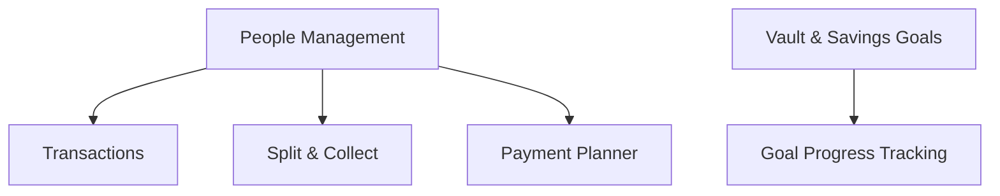

 <div align="center">

# LedgerFlow

### Smart Ledger Management System

Manage transactions, contacts, shared expenses, savings goals, and upcoming payments in one connected workspace.

[](https://ledger-flow-six.vercel.app/)
[](https://github.com/Vincentmx2000/LedgerFlow)

<br/>


[Features](#-features) · [Tech Stack](#-tech-stack) · [Getting Started](#-getting-started) · [API Reference](#-api-overview)

</div>

---

## 📌 About

**LedgerFlow** is a full-stack ledger and money-management application built with the MERN stack. It brings contact management, financial transactions, shared expenses, savings goals, and payment planning into one workspace.

Inspired by business management tools such as Zoho Books and Vyapar, LedgerFlow focuses on keeping financial activities organized and easy to track through a clean, connected interface.

**Live application:** https://ledger-flow-six.vercel.app/

## ✨ Features

| Module | Description |
|---|---|
| **People Management** | Manage customers, suppliers, staff, vendors, and consultants with search, filters, and custom roles. |
| **Transactions** | Record financial transactions, payments, receipts, purchases, and expenses with clear inflow and outflow tracking. |
| **Vault** | Create savings wallets for specific goals, set targets, add funds, and track progress. |
| **Split & Collect** | Divide expenses among multiple people, split amounts equally, validate totals, and track payment status. |
| **Planner** | Schedule upcoming payments, collections, and expenses; track due dates and completion status. |
| **Authentication** | Register and sign in using JWT-based authentication. |
| **Dynamic Roles** | Create custom contact roles and use them in filters and contact forms. |
| **Responsive Interface** | Navigate the application's modules through a consistent, user-friendly interface. |

## 🔗 How the Modules Connect



Contacts can be associated with transactions, shared expenses, and planned activities. Vaults provide a separate way to track money reserved for specific savings goals.

## 🖥️ Screenshots

Screenshots can be added to `docs/screenshots/` as the project evolves.

| Landing Page | Dashboard |
|---|---|
| 
 | 
 |

| People Management | Vault |
|---|---|
| 
 | 
 |

## 🛠️ Tech Stack

### Frontend
- React
- Vite
- JavaScript (ES6+)
- Tailwind CSS
- React Router
- Lucide icons

### Backend
- Node.js
- Express.js
- REST APIs
- JWT authentication

### Database
- MongoDB
- Mongoose

### Deployment
- **Frontend:** [Vercel](https://vercel.com/)
- **Backend:** [Render](https://render.com/)
- **Database hosting:** MongoDB Atlas, if configured

## 📂 Project Structure

```text
LedgerFlow/
├── client/
│   ├── public/
│   ├── src/
│   │   ├── components/
│   │   ├── context/
│   │   ├── services/
│   │   └── ...
│   ├── index.html
│   └── package.json
├── server/
│   ├── controllers/
│   ├── middleware/
│   ├── models/
│   ├── routes/
│   ├── server.js
│   └── package.json
└── README.md
```

*The directory tree is illustrative; actual files may vary by version.*

## 🚀 Getting Started

Follow these instructions to run LedgerFlow locally.

### Prerequisites

- [Node.js](https://nodejs.org/)
- [Git](https://git-scm.com/)
- [MongoDB](https://www.mongodb.com/) or a MongoDB Atlas connection

### 1. Clone the Repository

```bash
git clone https://github.com/Vincentmx2000/LedgerFlow.git
cd LedgerFlow
```

### 2. Configure the Backend

```bash
cd server
npm install
```

Create a `.env` file in the `server/` directory using the project's environment-variable template, if available.

Example configuration:

```env
PORT=5000
MONGO_URI=your_mongodb_connection_string
JWT_SECRET=your_private_random_secret
```

Use the exact environment-variable names expected by your server code. Never commit real credentials or secrets to GitHub.

Start the backend using the script defined in `server/package.json`. For example, if a `dev` script exists:

```bash
npm run dev
```

The backend should be available at `http://localhost:5000` if that is the configured port.

### 3. Configure the Frontend

Open a second terminal from the project root:

```bash
cd client
npm install
npm run dev
```

Vite typically serves the application at:

`http://localhost:5173`

The development proxy forwards `/api` requests to the local backend when configured in `vite.config.js`.

### 4. Open LedgerFlow

Visit `http://localhost:5173`, create an account if registration is enabled, and explore the available modules.

## 🌐 Deployment

LedgerFlow uses separate hosting for its frontend and backend.

| Component | Platform | URL |
|---|---|---|
| Frontend | Vercel | [Open LedgerFlow](https://ledger-flow-six.vercel.app/) |
| Backend | Render | [Backend URL](https://ledgerflow-jw1r.onrender.com) |
| Repository | GitHub | [Source Code](https://github.com/Vincentmx2000/LedgerFlow) |

### Production Configuration

- Configure the frontend API URL in Vercel using the environment variable expected by the client, such as `VITE_API_URL`.
- Configure backend environment variables in Render.
- Allow the deployed frontend origin in the backend's CORS configuration.
- Configure MongoDB credentials securely in the backend environment.
- Push changes to the connected GitHub branch to trigger deployments when automatic deployments are enabled.

## 🔌 API Overview

The following routes describe the main API areas implemented in the project.

| Module | Base Route |
|---|---|
| Authentication | `/api/auth` |
| People | `/api/people` |
| Roles | `/api/roles` |
| Transactions | `/api/transactions` |
| Vaults | `/api/vaults` |
| Split & Collect | `/api/split-collections` |
| Planner | `/api/plans` |
| Health Check | `/api/health` |

Protected routes require the authentication mechanism configured by the backend, typically an `Authorization: Bearer <token>` header for JWT authentication.

## 🔒 Security Notes

- Keep database credentials and authentication secrets out of source control.
- Use environment variables for production configuration.
- Configure CORS to allow only the intended frontend origins.
- Use HTTPS for production requests.
- Avoid exposing sensitive server errors or authentication details to clients.

## 🗺️ Future Improvements

Potential areas for future development include:

- Financial summaries and visual analytics.
- Exportable transaction reports.
- Improved automated testing.
- Additional accessibility and mobile usability enhancements.

These are potential improvements, not claims about existing functionality.

## 👨‍💻 Author

**Vincent** — Full-Stack Developer

[](https://github.com/Vincentmx2000)

---

<div align="center">

**LedgerFlow — Keep your finances organized.**

[Live Demo](https://ledger-flow-six.vercel.app/) · [GitHub Repository](https://github.com/Vincentmx2000/LedgerFlow)

</div>
